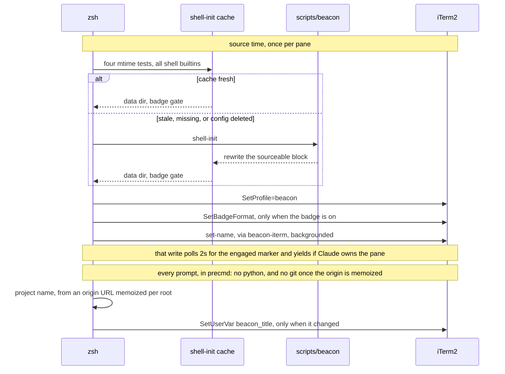
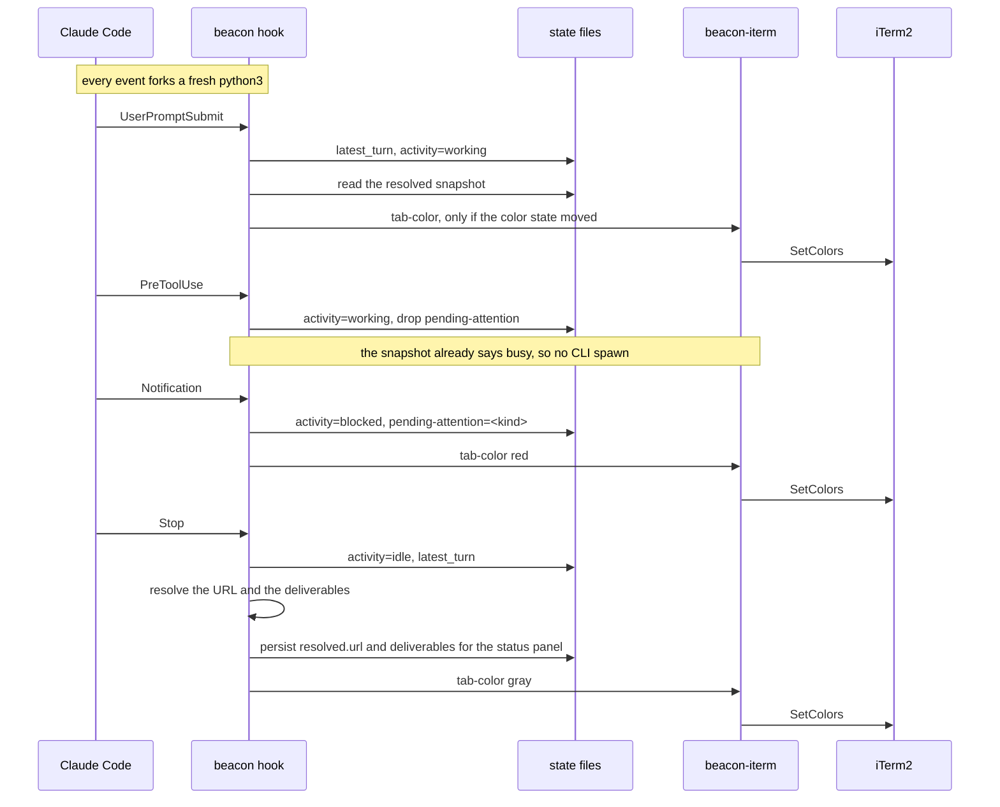
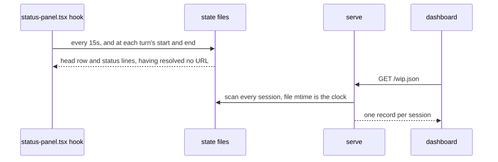

# beacon

**beacon** what every session is doing.


At-a-glance awareness across concurrent Claude Code sessions: a status panel above the Claude Code prompt, a CLI and browser dashboard on any terminal, and painted iTerm2 chrome.

**[Read the docs](https://chris-peterson.github.io/beacon/)** for install, usage, and the full behavioral spec.

This README covers working *on* beacon. To install or use the released plugin, follow the docs site.

## Render surfaces

Every place beacon shows state has one name, and the code, the spec, commits, and the docs all use it. The tab strip runs down the left, as beacon's iTerm2 layout puts it.

<table>
  <tr>
    <td rowspan="2" style="background:#21222c;vertical-align:top;padding:16px" width="25%">
      <table width="100%" cellspacing="8" cellpadding="12">
        <tr><td style="background:#bd93f9;color:#282a36;text-align:center;font-size:1.2em"><b>Tab</b></td></tr>
        <tr><td style="background:#bd93f9;color:#282a36;font-size:1.2em">🚀 project<br>&nbsp;&nbsp;task</td></tr>
        <tr><td style="background:#bd93f9;color:#282a36;font-size:1.2em">project<br>&nbsp;&nbsp;task</td></tr>
      </table>
    </td>
    <td style="background:#21222c;padding:0" width="75%">
      <table width="100%" cellspacing="8" cellpadding="12">
        <tr>
          <td style="background:#44475a;color:#f8f8f2;vertical-align:middle;text-align:center;font-size:1.2em" width="80%"><b>Pane</b><br>left to your own profile</td>
          <td style="background:#bd93f9;color:#282a36;vertical-align:top;text-align:center;font-size:1.2em"><b>Badge</b><br>opt-in</td>
        </tr>
      </table>
    </td>
  </tr>
  <tr>
    <td style="background:#21222c;padding:0">
      <table width="100%" cellspacing="8" cellpadding="12">
        <tr><td style="background:#8be9fd;color:#282a36;text-align:center;font-size:1.2em"><b>Status panel</b><br>mode ribbon, then project · branch · task, then delivered · open CRs · open issues; the mode in the footer</td></tr>
      </table>
    </td>
  </tr>
  <tr>
    <td colspan="2" style="background:#21222c;padding:0">
      <table width="100%" cellspacing="8" cellpadding="12">
        <tr>
          <td style="background:#8be9fd;color:#282a36;text-align:center;font-size:1.2em"><b>Sessions view</b></td>
          <td style="background:#8be9fd;color:#282a36;text-align:center;font-size:1.2em"><code>wip</code><br>snapshot</td>
          <td style="background:#8be9fd;color:#282a36;text-align:center;font-size:1.2em"><code>watch</code><br>live terminal</td>
          <td style="background:#8be9fd;color:#282a36;text-align:center;font-size:1.2em"><code>serve</code><br>browser dashboard</td>
        </tr>
      </table>
    </td>
  </tr>
</table>

<sup><span style="display:inline-block;width:12px;height:12px;background:#bd93f9;border-radius:2px"></span> iTerm2 render adapter (macOS + iTerm2 only) · <span style="display:inline-block;width:12px;height:12px;background:#8be9fd;border-radius:2px"></span> Any terminal (read straight from the state files; the status panel needs Claude Code 2.1.287 or later)</sup>

| Surface | Carries | Spec | Docs |
|:---|:---|:---|:---|
| **Tab** | Label: `project` over `task`, led by the mode glyph or a block glyph. Color: `activity`. Line 1 doubles as the OS window title | §4.6 `TAB`, §4.8 `TITLE` | [Layout](https://chris-peterson.github.io/beacon/#/iterm/layout) |
| **Badge** | Project and activity color, or one line another tool sets; off by default | §4.3 `BADGE` | [Turning the badge on](https://chris-peterson.github.io/beacon/#/iterm/layout?id=turning-the-badge-on) |
| **Status panel** | This session's declared mode as a ribbon in the mode's hue, with its note, and as a label in Claude Code's footer; then its project, branch, and task, its status lines, and buttons for the project page and the editor; drawn by a hooks module in Claude Code's band above the prompt, in any terminal | §4.9 `STATUSLINE` | [The status panel](https://chris-peterson.github.io/beacon/#/statusline) |
| **Sessions view** | Every session at once: `wip` / `watch` / `serve` | §3.8 `WIP` | [The sessions view](https://chris-peterson.github.io/beacon/#/cli?id=the-sessions-view), [demo](https://chris-peterson.github.io/beacon/#/demo) |

Adding a surface is a spec change (§4.1), not an implementation choice.

## Develop / install from a clone

Working on beacon directly (no marketplace):

```bash
git clone https://github.com/chris-peterson/beacon ~/src/beacon
python3 ~/src/beacon/scripts/beacon install
```

This wires up the shell side just like an installed `beacon install`, but pointed at your clone. To get the plugin side (slash commands, hooks, ambient rules) loaded into Claude Code, use the marketplace install path: `claude --plugin-dir` may not register hooks reliably across versions.

## Dependencies

The sessions view (`wip` / `watch` / `serve`) needs only:

- Python 3: the plugin script and CLI run via the system `python3`.

The per-pane painting layer (tab label, color, and mode glyph; spec §4) additionally needs:

- macOS with iTerm2: the render adapter is iTerm2-specific. `install` detects iTerm.app and skips these steps when it's absent.
- zsh: the shell snippet relies on zsh-only features.

The always-on serve service (`beacon serve install`) uses launchd on macOS, systemd user units on Linux.

## Repository layout

| Path | What |
|:---|:---|
| `bin/beacon-iterm` | Stateless CLI that translates subcommands to iTerm2 OSC sequences (D2) |
| `scripts/beacon` | Plugin script: hook handlers, COR resolver, slash command, install (D3) |
| `shell/beacon.zsh` | Sourceable zsh snippet: switches the pane into the beacon profile and keeps its window title on the project at every prompt |
| `hooks/`, `commands/` | Claude Code plugin glue, including the status panel's hooks module (`hooks/status-panel.tsx`) |
| `rules/` | Ambient rules emitted into context at SessionStart by `hooks/emit-rules.sh` |
| `dashboard/index.html` | Self-contained reference dashboard `serve` hosts at `/` |
| `iterm/profile.json.template` | The `beacon` dynamic profile: badge sizing, font, and margins |
| `docs/` | Docsify site sources; the site renders the EARS-style behavioral spec (D1) from `SPEC.md` |

## Tests

```bash
just test                              # or:
python3 -m unittest discover -s tests -v
```

The suite is pure stdlib `unittest`: it loads `scripts/beacon` via importlib and mocks `_cli` and `sys.platform`, so the iTerm2 paint paths and the launchd/systemd/Windows branches are all exercised without a Mac. `.github/workflows/test.yml` runs it on an `ubuntu` / `macos` / `windows` × Python `3.9`–`3.13` matrix on every push and PR, which is what guards the cross-platform fallbacks (session-id seeding, `watch` polling) from regressing.

## Architecture

beacon ships as three deliverables with a hard boundary between them:

| ID | What | Form |
|:---|:---|:---|
| D1 | Behavioral spec | [SPEC.md](SPEC.md) |
| D2 | `beacon-iterm` CLI | Stateless OSC-emitter executable |
| D3 | `beacon` Claude Code plugin | Hooks, slash commands, ambient rule, COR resolver, shell integration |

D3 invokes D2 for every iTerm2 surface change. D2 has no Claude awareness: it can be used from any caller, which keeps the seam clean for future render-target CLIs (`beacon-tmux`, `beacon-kitty`) or driver plugins.

The behavioral contract for hooks vs shell is documented in [`AGENTS.md`](AGENTS.md): the plugin owns `mode` (with its note) and `activity`, and writes to its user-var slots; the shell owns the window title of a pane Claude isn't running in (`beacon_title`) and writes to a disjoint slot; the CLI is unaware of either.

`beacon wip` / `watch` / `serve` (spec §3.8) are the terminal-agnostic sessions surface on D3: they enumerate every session's state and render a snapshot (TTY, JSON, or localhost HTTP) for external dashboards rather than painting iTerm2, so they don't route through D2 and work in any terminal. `beacon serve install` keeps `serve` running under launchd/systemd. The per-session state-file directory is the single source of record: the iTerm2 paint and the sessions view both read it, and `serve` re-reads it per request, so they can't disagree.

## What runs when

Two writers, and the difference between them explains every caching decision below: the shell is **one long-lived process** per pane, so a last-value sentinel in a variable is enough to skip a repaint. Every hook is a **fresh `python3`**, so a plugin-side gate only works if it lives on disk.

A pane with no Claude in it pays python once, at source, and never again:



Under Claude the shell's `precmd` can't run (Claude holds the prompt), so the hooks carry it, and the `Stop` hook is where the once-per-turn work lands:



Readers never reach a forge. The status panel polls and the dashboard requests, so both read state files, which is why the URL is resolved on the hooks that already pay for git and the forge, and persisted. The panel's head row reads local git at the session's directory for the branch, and nothing more:



| Cached value | Lives in | Recomputed when | Scope |
|:---|:---|:---|:---|
| Data dir + badge gate | `~/.config/beacon/shell-init<root>.zsh` | `scripts/beacon` or `config.json` is newer than the block, plus a presence flag, because an mtime test can't see a *deleted* config | One pane, keyed by plugin root |
| Origin URL per project root | `_BEACON_ORIGIN_URL` | Next `exec zsh`, which is when a `git remote set-url` shows up | The shell process |
| Last published user-var values | `_BEACON_LAST_*` sentinels | `chpwd` clears all of them | The shell process |
| Last-painted surfaces | `<DATA_DIR>/state/<hash>.resolved` | Every `apply()` (this snapshot is what lets a hook skip the CLI spawn) | The session, on disk |
| Resolved URL, label, project | `state/<hash>.resolved.url*` | SessionStart, and each `Stop` | The session, on disk |
| Origin URL, tack routes, and tack repo labels, python side | Module dicts in `scripts/beacon` | Nothing (the process exits with the hook) | One hook invocation |

Which state a session writes, and how its hash is seeded, is in [`AGENTS.md`](AGENTS.md); the requirements behind each surface are in [SPEC.md](SPEC.md).

## License

MIT. See [LICENSE](LICENSE).
