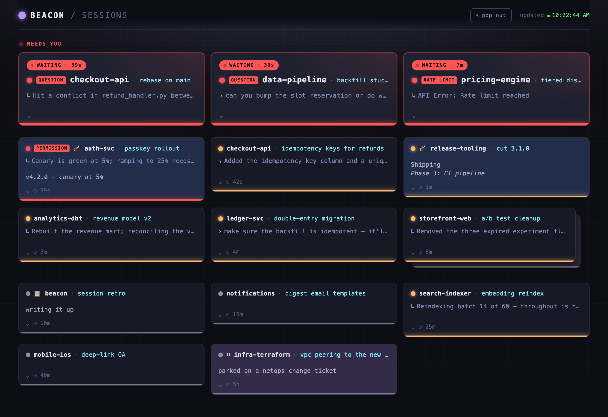
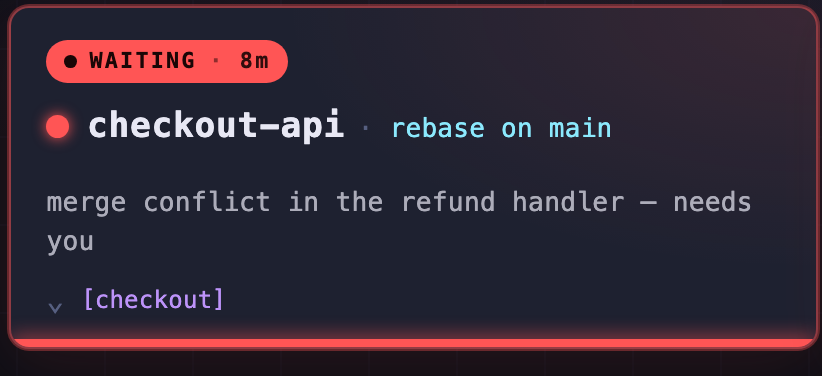

# Try the demo

The sessions view is hard to picture until you've seen a board full of concurrent work drift between states. The demo gives you that without wiring up real Claude Code sessions: it seeds a fictional commerce org's sessions, serves the real dashboard against it, and runs a calm simulation you can click through.

It's the fastest way to answer "what would beacon look like with my sessions in it?" On Windows or any non-iTerm terminal, the dashboard it serves *is* the whole product, so the demo doubles as a full tour.

## Run it

The demo lives in the repo, so clone and run it directly, with no install and no real sessions:

```bash
git clone https://github.com/chris-peterson/beacon
cd beacon
python3 dev/demo.py
```

Then open <http://127.0.0.1:8788/>. Press `Ctrl-C` to stop.

Everything the demo writes lands in a throwaway directory (`/tmp/beacon-demo`) and an isolated tack home, so your real beacon state and tack routes are untouched. Re-running reseeds from scratch.

A few flags worth knowing:

```bash
python3 dev/demo.py --port 9000      # serve on a different port
python3 dev/demo.py --interval 8     # seconds between simulation ticks (default 5)
python3 dev/demo.py --seed-only      # write static sessions and exit (no serve)
```

## What you'll see

A card per session, colored by what each is doing right now, in the same colors beacon paints on an iTerm2 pane, in one list with no headings. It starts in **status** order: the sessions waiting on you (or flagged) first, glowing red, then the working, then the idle, with paused and finished sessions below a rule on a darker ground. The sort switch in the header shows which order is in force; click `recency` for newest first, and the browser remembers which you chose. A waiting session always takes its own slot, never tucked behind another card for the same project:



- **Gray**: idle, at rest, waiting for its next prompt
- **Amber**: Claude is working
- **Red**: waiting for you, such as at a permission prompt, or flagged for your attention
- **Mode tints**: a session you've moved into a cycle takes its status panel ribbon's hue: `pause` (muted purple), `release` (navy), `done` (near-black), and `retro` a plain card with its `📋` glyph. See [The beacon palette](/palette).

Each card carries the recall context a glance needs: the project, the current task, the [tack](https://github.com/chris-peterson/tack) route chip, the branch, and a free-text note about *why* it's in this state.



## Click a red card to clear it

The simulation mirrors how real sessions behave: sessions churn quietly between working and idle, but every so often one **stalls**: it blocks on you and turns red. Stalled sessions stay stalled and pile up; only you clear them.

A red card is the only kind you can click. In the demo, clicking it **returns that session to its agent**, the stand-in for what a live `beacon serve` does, which is raise the session's iTerm2 window so you can answer the prompt. The card flips back to working and the red ring clears. Hover a card and the `×` forgets that session outright.

Let the board run for a minute and you'll watch it drift redder as work stalls, then clear it card by card. That's the loop the sessions view is built for.

## The tab stack

**tab stack** (in Chrome and Edge) opens a small window that stays on top of everything else, so your sessions stay in view while you work in your editor. It holds the same sessions as the dashboard, in the same order, stacked in one column, each drawn as that session's [status panel](/statusline): the mode's bar, the project, branch, and task with buttons to raise its window and open its project page and directory, and the change requests and issues underneath. Click a tile's top row to show its latest turn.

## On Windows or a non-iTerm terminal

The sessions view reads session state and paints no pane, so it runs anywhere Python 3 does; the screenshots above are the same dashboard a Windows or Linux coworker sees. Install the plugin, run `beacon serve`, open `http://127.0.0.1:8787/`, and you have this view over your own sessions. The per-pane tab painting is an iTerm2 adapter and is skipped automatically off iTerm2.

See [On Windows or a non-iTerm terminal](/?id=on-windows-or-a-non-iterm-terminal) for the install steps.

## On macOS + iTerm2: per-pane painting

iTerm2 gets everything the demo shows, plus the same state painted onto each pane's tab (its label, color, and mode glyph), so you can scan concurrent panes without opening the dashboard at all. The demo serves only the dashboard; the per-pane surfaces appear once you install beacon and run real sessions. See [Layout](/iterm/layout) for the full anatomy.

## Next steps

[Install beacon](/?id=install) to run it over your own sessions.
