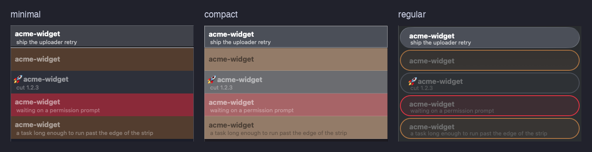
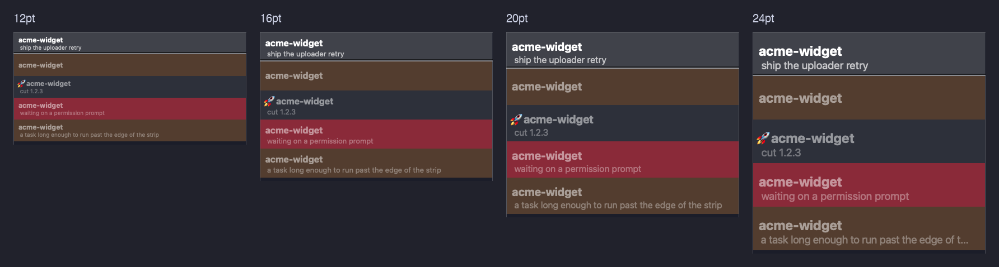

# Layout

On macOS with iTerm2, beacon paints each session's state onto its own pane: the tab's label and color, a status bar, and a background for the mode cycles. Where the [dashboard](/demo) gathers every session into one browser view, per-pane painting works the other way: it puts the state *on the pane itself*, so a glance across a wall of split panes or a row of tabs tells you which session needs you without focusing any of them or opening the dashboard.

These surfaces are an iTerm2 render adapter, so they're macOS + iTerm2 only. On any other terminal beacon skips them and you use the [dashboard](/demo) instead, which shows the same state.

<!--
  These figures are drawn in HTML from the spec palette (THEME-02 / THEME-03)
  rather than screenshotted, because the iTerm2 surfaces don't exist off macOS.
  Preview them by serving docs/ (`python3 -m http.server --directory docs`).

  The pf- prefix stays clear of the bcn- namespace that the marketplace hub's
  session.css owns: shipyard links that stylesheet into every plugin whose
  plugin.yml declares a suite, its rules land after this block in the cascade,
  and its .bcn-tab background resolves through a --bcn-state var these figures
  never set, so an equal-specificity name here silently loses its background.
-->
<style>
@import url('https://fonts.googleapis.com/css2?family=JetBrains+Mono:wght@400;700&display=swap');
.panefig {
  --abyss: #21222c; --body: #282a36; --bar: #30323e; --fg: #f8f8f2;
  --identity: #9aa3c0; --sep: #a0a4b3; --pink: #ff79c6;
  /* Tab figures paint the tab weights (TAB-04): iTerm2's Minimal style fills
     the whole tab, so this is what a tab actually shows. */
  --ready: #40424a; --busy: #856038; --blocked: #e64c4c;
  --green: #50fa7b;
  --mono: "JetBrains Mono", ui-monospace, "SF Mono", Menlo, monospace;
  max-width: 720px; margin: 1rem 0;
}
.pf-win { border: 1px solid rgba(139,233,253,0.14); border-radius: 13px; overflow: hidden; background: var(--body); box-shadow: 0 18px 40px rgba(0,0,0,0.45); }
.pf-title { display: flex; align-items: center; gap: 0.6rem; background: var(--abyss); border-bottom: 1px solid rgba(248,248,242,0.07); padding: 0.6rem 0.85rem; }
.pf-dots { display: inline-flex; gap: 0.45rem; }
.pf-dots i { width: 11px; height: 11px; border-radius: 50%; display: block; }
.pf-dots i:nth-child(1) { background: #ff5f57; }
.pf-dots i:nth-child(2) { background: #febc2e; }
.pf-dots i:nth-child(3) { background: #28c840; }
.pf-wintab { display: inline-flex; flex-direction: column; font: 12px var(--mono); line-height: 1.4; border-radius: 6px; padding: 0.2rem 0.7rem; background: color-mix(in srgb, var(--ready) 18%, transparent); box-shadow: inset 0 0 0 1px color-mix(in srgb, var(--ready) 32%, transparent); }
.pf-wintab b { font-weight: 700; color: var(--ready); letter-spacing: 0.04em; }
.pf-wintab .t { color: var(--identity); padding-left: 0.85em; }
/* the strip is one fixed-layout row, so it scrolls rather than wraps once the
   viewport is narrower than it; wrapping would misrepresent what iTerm2 draws */
.pf-bar { display: flex; align-items: center; gap: 0.55rem; background: var(--bar); font: 13px var(--mono); padding: 0.4rem 0.7rem; white-space: nowrap; overflow-x: auto; scrollbar-width: thin; }
.pf-act { color: var(--pink); font-weight: 700; }
.pf-sep { color: var(--sep); }
.pf-proj { color: var(--identity); }
.pf-proj b { color: var(--green); font-weight: 700; }
.pf-spring { flex: 1 1 auto; }
.pf-branch { color: var(--green); }
.pf-branch.diverged { color: var(--busy); }
/* dashed because it is off by default, and it shows <b> as text because that is what iTerm2 draws */
.pf-ptitle { display: flex; align-items: center; gap: 0.6rem; background: var(--abyss); font: 12px var(--mono); color: var(--identity); padding: 0.25rem 0.7rem; border-bottom: 1px dashed rgba(248,248,242,0.18); }
.pf-ptitle .x { color: var(--sep); }
.pf-body { position: relative; font: 13px var(--mono); color: var(--fg); padding: 0.85rem 0.9rem 1.1rem; min-height: 96px; }
.pf-body .prompt { color: var(--green); }
.pf-sl { margin-top: 1.1rem; font-size: 12px; color: var(--identity); }
.pf-mk { display: inline-flex; align-items: center; justify-content: center; width: 1.05em; height: 1.05em; margin-left: 0.3em; border-radius: 50%; background: #8be9fd; color: #21222c; font: 700 0.62em/1 ui-sans-serif, system-ui, sans-serif; vertical-align: super; position: relative; top: -0.15em; }
.pf-legend { list-style: none; counter-reset: panefig; margin: 0.9rem 0 0; padding: 0; display: grid; gap: 0.5rem; }
.pf-legend li { counter-increment: panefig; display: grid; grid-template-columns: 1.4rem 1fr; align-items: start; font-size: 0.9rem; color: inherit; }
.pf-legend li::before { content: counter(panefig); display: inline-flex; align-items: center; justify-content: center; width: 1.15rem; height: 1.15rem; border-radius: 50%; background: #8be9fd; color: #21222c; font-weight: 700; font-size: 0.72rem; }
.pf-legend b { color: inherit; font-weight: 600; }
.panefig code { font: 0.85em var(--mono); background: rgba(128,128,128,0.18) !important; padding: 0.05em 0.35em; border-radius: 4px; color: inherit !important; }
.pf-striprow { display: grid; gap: 0.75rem; }
.pf-strip { border: 1px solid rgba(139,233,253,0.14); border-radius: 9px; overflow: hidden; }
.pf-strip .cap { font-size: 0.85rem; color: #cdd2e6; padding: 0.45rem 0.7rem; background: var(--body); }
.pf-states { display: grid; grid-template-columns: repeat(auto-fit, minmax(11rem, 1fr)); gap: 0.75rem; }
.pf-chip { border: 1px solid rgba(139,233,253,0.14); border-radius: 10px; background: var(--body); padding: 1rem 0.9rem 0.8rem; text-align: center; }
.pf-chip .b { font: 700 19px/1.15 var(--mono); line-height: 1.3; color: var(--fg);
  border-radius: 6px; padding: 0.7rem 0.8rem; text-align: left; }
.pf-chip .b .task { display: block; font-weight: 400; font-size: 0.8em; opacity: 0.82;
  padding-left: 0.85em; }
.pf-chip .b.ready { background: var(--ready); }
.pf-chip .b.busy { background: var(--busy); }
.pf-chip .b.blocked { background: var(--blocked); }
.pf-chip .cap { margin-top: 0.6rem; font-size: 0.82rem; color: #cdd2e6; }
.pf-tabcol { display: flex; gap: 1.1rem; align-items: flex-start; flex-wrap: wrap; }
.pf-tabstrip { display: grid; gap: 5px; width: 15rem; flex: 0 0 auto; }
.pf-tab { display: flex; align-items: center; font: 600 13px var(--mono); color: var(--fg); background: var(--body); border-radius: 5px; padding: 0.7rem 0.75rem; }
.pf-tab .pf-lbl { display: flex; flex-direction: column; line-height: 1.35; min-width: 0; }
.pf-tab .t { font-weight: 400; opacity: 0.82; padding-left: 0.85em; }
.pf-tab.ready { background: var(--ready); }
.pf-tab.busy { background: var(--busy); }
.pf-tab.blocked { background: var(--blocked); }
/* this caption sits beside the strip on the page, not inside a dark panel like
   the other .cap variants, so it takes the page's own text color, not theirs */
.pf-tabcol .cap { flex: 1 1 12rem; font-size: 0.9rem; color: inherit; line-height: 1.5; align-self: center; }
</style>

## Anatomy of a painted pane

Each surface beacon renders through has a number here, and [Settings by surface](#settings-by-surface) uses the same numbers for every setting beacon changes. (The figure draws the tabs along the top; beacon's layout puts them in a strip down the left.)

<div class="panefig">
  <div class="pf-win">
    <div class="pf-title">
      <span class="pf-dots"><i></i><i></i><i></i></span>
      <span class="pf-wintab"><b>claude-marketplace<span class="pf-mk">1</span></b><span class="t">Redesign the install flow</span></span>
    </div>
    <div class="pf-bar">
      <span class="pf-act">↖ web</span>
      <span class="pf-spring"></span>
      <span class="pf-proj">claude-marketplace</span>
      <span class="pf-sep">│</span>
      <span class="pf-branch">main</span>
      <span class="pf-sep">│</span>
      <span class="pf-act">↗ code<span class="pf-mk">2</span></span>
    </div>
    <div class="pf-ptitle">
      <span class="x">✕</span>
      <span>&lt;b&gt;claude-marketplace&lt;/b&gt;<span class="pf-mk">3</span></span>
      <span class="pf-spring"></span>
      <span class="x">≡</span>
    </div>
    <div class="pf-body">
      <div><span class="prompt">›</span> run just build<span class="pf-mk">4</span></div>
      <div class="pf-sl">#61 · #58<span class="pf-mk">5</span></div>
    </div>
  </div>
  <ol class="pf-legend">
    <li><span><b>Tab</b>: the project, with the task indented under it, colored by the session's <em>activity</em> and led by the <em>mode</em>'s glyph when one is declared. Two slots, two axes, so a releasing session that needs you shows both at once. Line 1 is also the single-line OS window title, so a window you <code>/rename</code> keeps its project context in Mission Control and the window switcher.</span></li>
    <li><span><b>Status bar</b>: along the top of the window: the <code>↖ web</code> button, the project's name, the branch colored by its git sync state, and the <code>↗ code</code> button. <a href="#/iterm/layout?id=the-status-bar">The status bar</a> covers each.</span></li>
    <li><span><b>Per-pane title bar</b>: iTerm2's bar across the top of a pane, with the pane's close button and menu. Off by default, because it shows the session name on one line with <code>&lt;b&gt;</code> as text; <a href="#/iterm/layout?id=per-pane-title-bars">Per-pane title bars</a> turns it on.</span></li>
    <li><span><b>Pane</b>: left to Claude Code and your profile, except while a mode is declared, when it takes the mode's background color and a faint watermark.</span></li>
    <li><span><b>Status line</b>: Claude Code's footer rows, where beacon lists the mode's note and the session's PRs and issues.</span></li>
  </ol>
</div>

## The tab: color is the activity

The tab's color is the session's activity, and its label is the session's identity, so a strip of tabs tells you what every session is and which one needs you, with nothing focused. Its hue says whether the session is at rest, working, or waiting for you; the [tab look](#tab-look) decides which hues. A mode is carried by the label's glyph instead, so no mode competes for a hue, and neither does anything else: color is the only signal you read across every tab at once, so it answers *does this need me* alone.

On iTerm2 3.7.5 and later, Claude Code draws its own status on the tab too, so beacon offers two [tab looks](#tab-look). The figures in this section show the **legacy** look, where beacon's color is the only signal. Its hexes are each hue under its **tab weight**: beacon pins iTerm2's Minimal style, which fills the whole tab with the color rather than tinting it, and the states you see constantly recede so the rare one that wants you stands out. [The beacon palette](/palette) has the weights and the reasoning; a [dashboard card](/demo) paints the same hues unweighted, its dot being a fraction of the area.

<div class="panefig pf-states">
  <div class="pf-chip"><div class="b ready">checkout-api</div><div class="cap">idle, ready for a prompt</div></div>
  <div class="pf-chip"><div class="b busy">checkout-api<span class="task">refunds</span></div><div class="cap">Claude is working</div></div>
  <div class="pf-chip"><div class="b blocked">checkout-api<span class="task">refunds</span></div><div class="cap">waiting for you</div></div>
  <div class="pf-chip"><div class="b ready">⏸ checkout-api</div><div class="cap">paused: the glyph is the mode, the color is still the activity</div></div>
  <div class="pf-chip"><div class="b busy">🚀 checkout-api<span class="task">v2.5.0</span></div><div class="cap">releasing, and working</div></div>
  <div class="pf-chip"><div class="b blocked">🚀 checkout-api<span class="task">v2.5.0</span></div><div class="cap">releasing, and blocked on you</div></div>
</div>

The color is easiest to read with **tabs down the left side**. A left strip turns many sessions into a scannable column, one row per session, each carrying its state color, so you read every session at a glance without a single window focused. This is the layout beacon is tuned for, and why the [recommended layout](#recommended-layout) below sets the tabs wider and taller: the default strip is too cramped for the color to register.

<div class="panefig pf-tabcol">
  <div class="pf-tabstrip">
    <div class="pf-tab blocked"><span class="pf-lbl">checkout-api<span class="t">refunds</span></span></div>
    <div class="pf-tab busy"><span class="pf-lbl">widgets-web<span class="t">#42</span></span></div>
    <div class="pf-tab ready"><span class="pf-lbl">auth-svc</span></div>
    <div class="pf-tab busy"><span class="pf-lbl">beacon<span class="t">#14</span></span></div>
    <div class="pf-tab ready"><span class="pf-lbl">⏸ infra-tf</span></div>
  </div>
  <div class="cap">Five sessions, one column: <b>checkout-api</b> is red because it needs you, while two are working, one idle, and one is paused. No window focused, no dashboard open.</div>
</div>

Line 1 is the project name; line 2 is the task (or, on a parked or finished session, its note), and it collapses when there is neither. The hooks own the gray / amber / red dev transitions; you (or a skill) drive the mode cycles: `/beacon:pause "leaving for lunch"`, and from the CLI `beacon release`, `beacon retro`, `beacon done` (or any `beacon status …`). A pause note rides line 2 of the tab in place of the task, and also shows in the [dashboard](/demo) and the [status line](#the-status-line); the next prompt clears it.

### Tab look

From iTerm2 3.7.5, Claude Code reports its own status to the terminal through the [Program Status Protocol](/program-status), and iTerm2 draws it on the tab: a dot by the tab number, and the status word at the front of the task line (`<status> – <task>`), the whole line in the status color.

| Claude's status | Dot | Task line |
|:---|:---|:---|
| working | orange | orange |
| waiting for you | blue, ringed when it first needs you | blue |
| finished, and you haven't typed since | green | green |
| idle, or finished and you've typed | green | gray |
| the turn failed | red | red |

beacon's **modern** look, the default, keeps those and paints each tab a dark fill for the text to read on, tinted toward the state's hue. A finished turn's green text says it's your turn, and it turns gray once you've looked. The ringed blue dot, and iTerm2's dock badge, mark the session that's waiting on a decision.

The **legacy** look turns Claude's reports off and paints the tab in beacon's colors alone: gray, amber, and red, with red for any session waiting on you.

```bash
beacon config tab.look legacy
beacon config tab.look modern
```

The switch writes `CLAUDE_CODE_DISABLE_TERMINAL_TITLE` in `~/.claude/settings.json`, which Claude Code reads at launch, so restart running sessions to move them over. If something else manages that file and overwrites it, `beacon doctor` says so.

### Turning the badge on

beacon can also paint an iTerm2 **badge**: the large project/task overlay in the pane's top-right corner. It's off by default, because the tab already carries the same two values and its color says the same thing. If you work in one window at a time rather than a strip of tabs, the badge is the bigger target: it's the one surface large enough to read in Mission Control / Exposé. Turn it on in `~/.config/beacon/config.json`:

```json
{ "badge": "on" }
```

Re-run `beacon refresh-iterm-profiles` to pick it up; the color follows the same states as the tab.

### Compact and Regular tabs



beacon is tuned for iTerm2's **Minimal** tab style by default, which fills each tab with its state color. It also supports **Compact**, which outlines the selected tab and fades the rest toward gray, and **Regular**, which on macOS 26 draws each tab as a pill: filled when selected, outlined in its color otherwise. Tell beacon which you use, so it weights the colors for that style, pads the label clear of Regular's rounded ends, and recommends the matching layout:

```
beacon config tab.style regular
```

Then run `beacon layout --write` to switch iTerm2's theme. `beacon config tab.style minimal` switches back.

If the label sits too close to the tab's edge, set how many spaces lead each line (project, then task). Under the modern [tab look](#tab-look), Claude's status leads the task line, so the task line takes no indent:

```
beacon config tab.indent.1 <spaces>
beacon config tab.indent.2 <spaces>
```

`reset` in place of a number returns that line to the style's default, and `beacon config tab.indent reset` returns both. Tabs repaint with the Compact weights on their next hook.

### Tab text size



beacon recommends 16pt tab labels. To change it:

```
beacon config tab.font-size 14
beacon layout --write
```

The size is an app-wide iTerm2 setting, so `beacon layout --write` applies it, and the tab height changes with it. iTerm2 centers the project line on the tab and hangs the task line below it, so a two-line label sits a little below center, more so at larger sizes. A taller tab doesn't change that; a smaller size does. `beacon config tab.font-size reset` returns to 16pt. `beacon config tab` lists every tab setting, and `beacon config tab reset` returns them all to their defaults.

### Larger tabs with small text

Small labels fit more of the task on line 2, but the tab shrinks with them and gets harder to click. Vertical padding makes the tab taller without changing the text:

```
beacon config tab.vertical-padding <points>
beacon layout --write
```

The padding (0 to 20 points, 0 by default) goes both above and below the label, so the tab grows by twice the value. `beacon config tab.vertical-padding reset` removes it.

### Per-pane title bars

iTerm2's per-pane title bar carries the pane's close button and menu, and beacon's layout turns it off: the bar shows the session name on one line, with the `<b>` tag as text and no task line. If you close panes with the mouse, turn it back on:

```
beacon config pane-title-bar on
beacon layout --write
```

Every pane gets the bar, including the only pane in a tab, so every pane has its close button. `beacon config pane-title-bar reset` turns the bars off again.

## The status bar

The status bar carries a fixed-layout strip the tab has no room for: `↖ web ⟷ project branch ↗ code`. It's part of a beacon-managed dynamic profile, so it appears once you're switched into the beacon profile (which `install` handles).

It carries the two actions a link can't take: typing a command into the pane, and launching a local app. Navigating to the session's URL is the [status line](#the-status-line)'s job, where it's a real hyperlink that works in any terminal.

The project chip names the project, and the branch beside it is colored by its git sync state:

<div class="panefig pf-striprow">
  <div class="pf-strip">
    <div class="pf-bar">
      <span class="pf-act">↖ web</span><span class="pf-spring"></span><span class="pf-proj">widgets</span><span class="pf-sep">│</span><span class="pf-branch">main</span><span class="pf-sep">│</span><span class="pf-act">↗ code</span>
    </div>
    <div class="cap">On the default branch, synced: the branch is green.</div>
  </div>
  <div class="pf-strip">
    <div class="pf-bar">
      <span class="pf-act">↖ web</span><span class="pf-spring"></span><span class="pf-proj">widgets</span><span class="pf-sep">│</span><span class="pf-branch diverged">fix/login</span><span class="pf-sep">│</span><span class="pf-act">↗ code</span>
    </div>
    <div class="cap">Ahead of upstream: the branch is amber.</div>
  </div>
  <div class="pf-strip">
    <div class="pf-bar">
      <span class="pf-act">↖ web</span><span class="pf-spring"></span><span class="pf-proj">notes</span><span class="pf-sep">│</span><span class="pf-act">↗ code</span>
    </div>
    <div class="cap">Outside a git repo, the chip names the directory and the branch slot is empty.</div>
  </div>
</div>

The chip needs no git repo, no remote, and no Claude session to have an answer, so it reads the same in every pane. Which **deliverable** you are on is the status line's job (a clickable `#42`), and the `↖ web` button opens it.

## The status line

Claude Code renders footer rows from a command you nominate, above its own badges and never overlapping terminal output. beacon supplies one, `beacon statusline`, and it works in **any** terminal, not just iTerm2.

What's on it, how to read the merge order, and how work gets onto the row are on the [status line](/statusline) page.

Whether the links are clickable is your terminal's call. iTerm2 renders them, and agterm does depending on its settings.

## What beacon doesn't paint

beacon paints the tab's color and label, the status bar, and (in a mode cycle only) the pane background. Everything else belongs to Claude Code, your own profile, or other tools, and beacon leaves it alone: the terminal foreground, the cursor color and shape, the tab title, and the pane background outside a mode. Those are your colors, not beacon's: its profiles inherit from the iTerm2 profile named `Default`. The behavior it does change, such as notifications and where a split opens, is listed under [Settings by surface](#settings-by-surface).

The window title is the one surface it *did* take over: beacon sets the session name, so a `/rename`d Claude session keeps its project in Mission Control, ⌘\`, and the Dock. The base profile turns off iTerm2's honoring of terminal-set titles to make that stick, so Claude Code's own title doesn't show.

## Recommended layout

beacon paints per-*profile* surfaces it fully controls (status bar, colors, mode backgrounds). The *shape* of the tab strip those colors ride on (where the tabs sit, how big they are) lives in iTerm2's **app-wide preferences**, not in any profile. None of these are per-profile keys, so a beacon dynamic profile can't carry them. beacon writes them to iTerm2's preferences instead, and only while iTerm2 is down, as described below.

The tab signal + two-line `project` / `task` label are tuned for a **tall left tab strip**. These settings make that strip readable. [CLI-18](/spec) lists each one: its `defaults` key, the value to set, the pane of Preferences that holds it, and why it matters.

Audit your current setup at any time. It reports only what differs and writes nothing:

```
beacon layout
```

beacon applies all of these; what you choose is when. The strip width is the exception: it's only a starting value, so once you've dragged the strip, your width stays.

Rather than hunt through the Preferences window, let beacon apply them for you:

```
beacon layout --write
```

It lists what differs and asks one question: restart iTerm2 now, or apply the settings the next time you quit it. The default is the next quit, so nothing closes unless you say so; `/beacon:install-beacon`, which has no terminal to ask on, takes that default. A restart is needed either way because iTerm2 holds its preferences in memory and rewrites the plist when it quits, so a write made while it's running is overwritten. **Restarting now closes every window and pane, including running sessions.** (Prefer the GUI? Most are under Appearance → Tabs; the status bar is under Appearance → General, and the Minimal side strip's tab height under Advanced → Tabs.)

That same in-memory copy is why the audit adds a caveat while iTerm2 is running: it reads the plist on disk, which is the effective value only once iTerm2 is down. When the audit reports every setting aligned but the tab strip disagrees, a write landed behind the running app and will be discarded on quit. Name the setting to write it regardless of what the plist says:

```
beacon layout --write --keys CustomTabBarFontSize
```

`beacon layout` is app-wide iTerm2 preferences. Its neighbor `beacon refresh-iterm-profiles` re-renders beacon's *own* dynamic profiles (the status bar, badge sizing, and mode backgrounds), which iTerm2 reloads live, so that one needs no restart. Reach for it after changing a status-bar button `label` in your config.

One case needs a restart anyway. iTerm2 3.7.0 decides a profile is dynamic by a key its loader writes, where 3.6.x used a `Dynamic` tag, so profiles saved before that upgrade read as ordinary saved profiles that already own beacon's Guids, and the loader skips the files they came from. `beacon doctor` reports it as `profiles live`, and re-rendering can't reach it.

iTerm2 fixes this itself with a one-shot migration, so the repair is to let it run again:

```
beacon refresh-iterm-profiles --remigrate
```

It clears the one preference gating that migration and leaves your profile list as it is. It confirms first, since the migration runs at launch and that means quitting iTerm2, closing every window and pane.

One related setting is yours alone, since beacon renders the same either way and leaves it as you set it: **pane/window dimming** (Appearance → Dimming). Dimming unfocused panes helps you spot the active one, but also dims beacon's colors on the very panes you're scanning.

## Settings by surface

Every setting beacon changes, grouped by the surface it shapes in the [anatomy](#anatomy-of-a-painted-pane) above, and named as iTerm2's Settings window names it. Where you can change one, the last column says how. A **No** setting is set back the next time beacon applies it: `beacon layout --write` (which `install` runs) for the app-wide ones, and `install` for the ones in beacon's profiles.

### ① Tab

| Setting | beacon sets | Why | Can you change it? |
|---|---|---|---|
| Show tab bar even when there is only one tab (Appearance → Tabs) | on | iTerm2 hides the tab bar for a window with one tab, which leaves that session no color and no label | No, the tab needs it |
| Theme (Appearance → General) | Minimal | Minimal fills the whole tab with the state color, the most legible form of the signal | Yes: `beacon config tab.style`, one of `minimal`, `compact`, `regular` ([Compact and Regular tabs](#compact-and-regular-tabs)) |
| Tab bar location (Appearance → Tabs) | Left | a left strip reads as a column, one row per session | No |
| Width of the left strip (drag its edge) | 300pt, only while unset | iTerm2's 150pt leaves the task line almost no room | Yes: drag the edge, and beacon keeps your width |
| Custom tab label font size (Advanced) | 16pt | iTerm2's 11pt is hard to read in a left strip | Yes: `beacon config tab.font-size`, 10 to 30 ([Tab text size](#tab-text-size)) |
| Use custom font size for tab labels? (Advanced) | Yes | the switch the size above needs | No, the size needs it |
| Default tab bar height, and Tab bar height (points) for the Minimal theme (Advanced) | derived from the font size | iTerm2's heights clip the task line | Yes, through the font size and `beacon config tab.vertical-padding`, 0 to 20 ([Larger tabs with small text](#larger-tabs-with-small-text)) |
| Prominence of selected tab underline indicator in the Minimal theme (Advanced) | 0.4 | at full strength the underline is brighter than the tab colors it sits under | No |
| Tabs have close buttons (Appearance → Tabs) | off | the strip is clicked all day to switch sessions, and a stray click on the button ends one | No |
| Disable tab bar tooltips? (Advanced) | Yes | the tooltip repeats the label and covers the neighboring tabs you're scanning | No |
| Show activity indicator (Appearance → Tabs) | off | Claude redraws its screen the whole time it works, so the spinner never stops and repeats the working color | No |
| Support basic HTML tags in tab titles (Appearance → Tabs) | on | the label bolds the project with `<b>`, which otherwise shows as text | No, the label needs it |
| Title Components (Profiles → General) | Session Name | the tab and the window title show the name beacon sets | No, the label needs it |
| Applications in terminal may change the title (Profiles → General) | off | keeps programs in the pane from overwriting that name | No, the label needs it |

### ② Status bar

| Setting | beacon sets | Why | Can you change it? |
|---|---|---|---|
| Status bar enabled (Profiles → Session) | on | it's the status bar | No, the status bar needs it |
| Status bar location (Appearance → General) | Top | the bottom is where Claude Code draws the status line ⑤, and the two would stack | No |
| Height of the status bar in points (Advanced) | 32 | room for the buttons and the chips beside them | No |
| The two buttons' text and command | `↖ web`, `↗ code` | the actions a pane needs most: its PR or repo, and its directory in your editor | Yes: `statusbar.buttons` in your config ([Status-bar buttons](/statusbar)) |

### ③ Per-pane title bar

| Setting | beacon sets | Why | Can you change it? |
|---|---|---|---|
| Show per-pane title bars (Appearance → Panes) | off | the bar shows the session name on one line, with `<b>` as text and no task line | Yes: `beacon config pane-title-bar on` ([Per-pane title bars](#per-pane-title-bars)) |
| …even if there is only one pane (Appearance → Panes) | on, while the bar is on | without it the only pane in a tab has no bar, and so no close button | Follows the setting above |

### ④ Pane

| Setting | beacon sets | Why | Can you change it? |
|---|---|---|---|
| Background color and image, in the mode profiles only (Profiles → Colors, Window) | a color and a faint watermark per mode | a declared mode reads across the whole focused pane, not only in the tab's glyph | No |
| Working Directory for New Split Panes (Profiles → General → Advanced Configuration) | Reuse previous session's directory | a split is usually more work in the same project; new tabs and windows follow your profile | No |

### ⑤ Status line

| Setting | beacon sets | Why | Can you change it? |
|---|---|---|---|
| `statusLine` in `~/.claude/settings.json` | `beacon statusline` | it's the status line | Yes: beacon sets it only when you have none |

### Alerts, progress, and the shell

These shape no surface of their own.

| Setting | beacon sets | Why | Can you change it? |
|---|---|---|---|
| Notification Center alerts (Profiles → Terminal) | off | macOS delivers these unreliably, while the tab color shows the same permission and idle prompts every time and stays until you act | No |
| Send escape sequence-generated alerts (Profiles → Terminal) | off | the same prompts, the same reason | No |
| Show progress bars (Profiles → Session) | off | each tab animates at its own pace, so the strip is in constant motion that says nothing the tab color doesn't | No |
| `terminalProgressBarEnabled` in `~/.claude/settings.json` | `false`, only with iTerm2 | iTerm2 spins a background tab's cell for Claude Code's progress reports, and no iTerm2 setting turns that spinner off | Yes: beacon sets it only when unset |
| `env.CLAUDE_CODE_DISABLE_TERMINAL_TITLE` in `~/.claude/settings.json` | unset for the modern [tab look](#tab-look), `"1"` for legacy, only with iTerm2 | it's the switch for Claude Code's status reports, which iTerm2 3.7.5+ draws on the tab | Yes: `beacon config tab.look` sets or removes it; `install` leaves a value it would have to change |
| `~/.zshrc` | a `source` line for `shell/beacon.zsh` | plain shell panes get their project, branch, and title from it | Yes: remove the line, and plain shell panes lose them |

## Setup

Per-pane painting is wired up by `beacon install` on macOS + iTerm2: it writes the dynamic profiles (the base profile and one per mode cycle), adds the shell `source` line, and switches new sessions into the beacon profile. iTerm2 reloads the profile live, so there's no restart. It closes by auditing the [recommended layout](#recommended-layout) and, when an app-wide setting differs, applying it with `beacon layout --write`, which asks whether to restart iTerm2 now or at your next quit. Off iTerm2 these steps are skipped automatically. See [Install](/?id=install).
