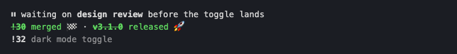
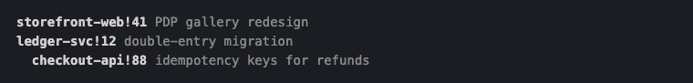
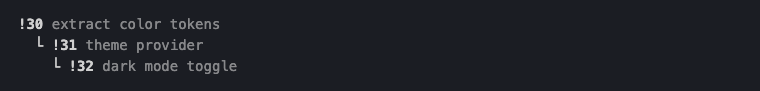
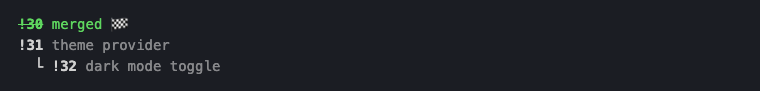
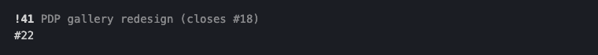

# The status panel

beacon draws a panel in the band Claude Code keeps above its prompt: which session this is, what it has shipped, the change requests (CRs) and issues it's working, and what order they merge in. It's the per-session view, and it works in any terminal Claude Code runs in. Every ref is a link, so the CR you need to look at next is one click away.

The panel is a hooks module that loads with the plugin, so there's nothing to install or turn on. It needs Claude Code 2.1.287 or later, the first to load hooks modules. Before 3.0 these lines were Claude Code's footer row (`statusLine`); an install takes back the `statusLine` beacon wrote, and leaves one you set yourself alone.

## The mode ribbon

When you've declared a mode, the panel opens with a bar three rows tall in that mode's hue: its glyph and name in bold, then your note. Your next prompt lifts a pause.

| Mode | Ribbon | Footer |
|:---|:---|:---|
| `pause` | muted purple | `paused` |
| `pause` set by auto-pause (`beacon config auto-pause`) | slate gray, led by 💤 | `inactive` |
| `release` | launch-sky navy | `releasing` |
| `done` | near-black | `done` |
| `retro` | none: its glyph leads the head row and its note takes the first status line | `retro` |

The mode's name also joins the labels at the right of Claude Code's footer (beside its own, like `memory paused`), so a collapsed panel still says it. The ribbon is how beacon marks a mode inside the pane in any terminal; through 2.x, iTerm2 repainted the whole pane instead. Its hues and the contrast they keep are on [the palette](/palette?id=modes-the-tab-glyph-and-the-ribbon).

## The head row

The first row names the session:

- the mode's glyph, when you've declared a mode with no ribbon (`📋`)
- the **project**, in bold
- the **branch**, led by `↑` / `↓` counts when it's ahead of or behind its upstream, and colored by how it sits against it: slate for the repo's default branch, cyan in step, yellow ahead or behind, orange with no upstream. A branch with an upstream links to its page on the forge; one without has no page to open, so it's plain text.
- the **task**, the label `beacon task` or `/rename` sets

Two buttons sit at the end of the row, named for what they open:

| Button | Opens | Key |
|:---|:---|:---|
| `↖` and the forge (`github`, `gitlab`, …) | the repo's project page | `w` |
| the editor (`code`, or yours) and `↗` | the session's directory in your editor | `c` |

The keys work once the band has focus (ctrl+x tab, or a click). Both buttons wait until beacon knows the session's directory, and the forge button needs an `origin` remote. A failure shows as a short message in Claude Code. To change what they run, see [the buttons](#the-buttons).

The panel shows this session only. Every session at once is the [sessions view](/cli?id=the-sessions-view): `beacon wip`, `beacon watch`, and the dashboard. To jump to another one, press ⌘K at a shell prompt in iTerm2 for [`beacon pick`](/cli?id=beacon-pick), or, from inside a session, `/beacon switch` lists the others in the band in the same order, the ones waiting on you first; press a number to raise that session's iTerm2 window. A session that has no state yet, in the moment after it starts, shows nothing rather than a placeholder.

## The status lines

Under the head row, one line per kind of thing, and a kind with nothing in it takes no line:

| Line | Shows |
|:---|:---|
| review | what a review open for you is about (a checkout or a CR), shown alone in place of the other lines until the review is released |
| mode note | for `retro`, which has no ribbon: why the session is in it, led by its glyph |
| delivered | what merged, closed, or released during this session, struck through, in green |
| open CRs | each with its title and the issues it closes |
| open issues | the ones no open CR on the row closes yet |



A CR moves to the delivered line when it merges, whether that happened through `/anchor:merge`, in the forge's web UI, or from another session. beacon reads each CR's state from GitHub or GitLab in the background as the session works, at most every ten minutes per CR, so the move can trail the merge by that much. An issue or CR closed without merging keeps being read, so if it's reopened it goes back to the open lines.

## Reading the order

Top to bottom is the order to merge in. **White is what you can merge now**; a CR that waits on another open CR on the row is indented under it and gray until that one merges. Weight still tells a CR (bold) from an issue (regular).



A **stacked** CR, one whose branch is built on another CR's branch, hangs off it with `└`. A CR that depends on another (a forge dependency) is indented with no mark. The difference matters at merge time: a stack merges as its base does and gets retargeted when the base lands, while a dependency waits until the CR it depends on merges.



When the base merges, it moves to the delivered line, and the rest of the stack moves up a level. beacon re-reads every CR in a stack or dependency chain together when any one of them changes, so the row moves to the new shape in one step.



## Refs and projects

A row in one project shows bare refs (`!41`, `#22`), the way you'd type them in that project:



Once the row spans two projects, every ref names its project (`storefront-web!41`), your own included, so a bare `!41` can't be mistaken for another repo's. A stacked CR drawn directly under its base stays bare, since a stack lives in one repo and the line above just named it.

## How things get on the row

The row holds what this session touched: the CRs and issues on its bound [tack](https://github.com/chris-peterson/tack) route, what sibling plugins announced it created or merged, the open CR for the current branch, and one hop out from each issue (the CRs that close it, the issues it's blocked by). Work from earlier sessions stays off. The full rules are [STATUS-03](/spec?id=status-03).

If something on the row isn't yours to track, take it off; it stays off for the rest of the session:

```bash
beacon drop '#22'
beacon drop 'checkout-api!88'
```

## The buttons

What each button runs comes from `~/.config/beacon/config.json` (or `$XDG_CONFIG_HOME/beacon/config.json` when you have that variable set), the file every beacon command reads. These are the defaults, so a config that says nothing behaves exactly like this:

```json
{
  "buttons": {
    "web":  { "cmd": "" },
    "code": { "cmd": "code" }
  }
}
```

Set only what you're changing: a missing or blank `cmd` means the default. A change applies on the next press, with nothing to re-run. The program is resolved on your `PATH` and then, failing that, by asking your login shell, so a git alias or a script both work (Claude Code hands a hooks module no interactive `PATH`, so `/opt/homebrew/bin` and friends are otherwise invisible). If neither can find it, the button says so and names the key to fix rather than quietly opening something else.

Both buttons hand your command the session's directory, the one Claude Code started in, but not the same way:

| Button | How the directory arrives |
|:---|:---|
| code | **appended as the last argument**: `"code -n"` runs `code -n /path/to/repo` |
| web | as the **working directory**, with no argument added, which is what lets `git web` read your `origin` remote |

### Placing values yourself

When the end of the command isn't where you want the path, put it where you want it:

```json
{ "buttons": { "code": { "cmd": "code -n {dir} --goto {dir}/README.md" } } }
```

| Placeholder | Expands to | Outside a repo |
|:---|:---|:---|
| `{dir}` | the session's directory | always available |
| `{project}` | the project's name | empty |
| `{branch}` | the current branch | empty |

- **`{dir}` turns off the automatic append** for the code button, so the path lands only where you put it. `{project}` and `{branch}` don't: they say nothing about the path, so it's still appended.
- **A value never splits into extra arguments.** A directory called `My Repo` stays one argument.
- **An argument that expands to nothing disappears** rather than becoming an empty string, so `"ed {branch}"` outside a repo is just `ed`.
- **A misspelled placeholder is an error** that names the real ones. Want a literal brace? Double it: `{{`. A bare `{}` isn't a placeholder, so `find -exec … {} \;` is safe.

There's no shell involved: the command is split into a program and arguments and run directly, so `$(…)`, pipes, and redirection aren't available. If you need those, point the button at a script on your `$PATH`. It resolves the same way and gets the directory the same way.

### What the web button opens

Left alone (`cmd` blank), it opens the repo's project page: the web URL of the directory's `origin` remote. It lands in the same place whatever the session is working on, so the PRs, issues, and releases a session touched are the status lines' links instead. It resolves when you press it, so there's no cached URL to go stale.

Set a `cmd` and you get wherever you point it:

```json
{ "buttons": { "web": { "cmd": "git web" } } }
```

`git web` is an alias you add to your own `~/.gitconfig`, not a git built-in. This one is [line 48 of `chris-peterson/gitconfig`](https://github.com/chris-peterson/gitconfig/blob/main/.gitconfig#L48):

```gitconfig
[alias]
	web = !"git rev-parse --is-inside-work-tree >/dev/null && open \"https://$(git remote get-url origin | sed 's/git@//' | sed 's/\\.git$//' | sed 's/:/\\//' )\""
```

It builds the URL from your `origin` remote, so SSH remotes work on GitHub and GitLab alike, and it does nothing outside a work tree. It opens with macOS `open`; on Linux, swap that for `xdg-open`.

### What the code button opens

The session's directory, in `code`. Add flags, or name a different editor entirely; the button is labeled with the program's name. Whatever you put here gets the directory appended:

```json
{ "buttons": { "code": { "cmd": "code -n" } } }
```

The default passes no flags of its own, just the directory. Check any flag you add against your editor's own `--help`: VS Code hands an option it doesn't recognize to Electron/Chromium, and on a cold start that makes it drop the directory and open a Welcome window instead. For a maximized window, use VS Code's own `window.newWindowDimensions` setting; it has no CLI flag for that.

## See it

To see these in your own terminal, with real color, strikethrough, and links, from a clone:

```bash
just statusline-demo
```

It renders the status lines for the scenarios on this page through beacon's own code against throwaway state. Nothing it shows comes from your sessions.
