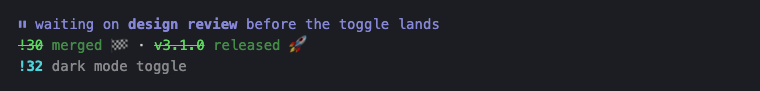
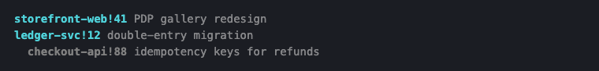
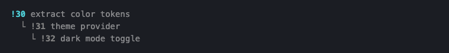
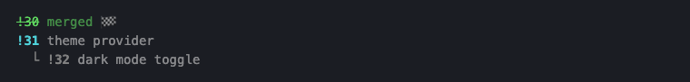
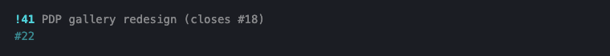

# The status line

beacon adds rows to the footer Claude Code draws under its prompt: what the session has shipped, the change requests (CRs) and issues it's working, and what order they merge in. It's the per-session view, and it works in any terminal. Every ref is a link, so the CR you need to look at next is one click away.

`beacon install` wires it into `~/.claude/settings.json`. It leaves a `statusLine` you already set alone and prints the block to add by hand instead.

## What's on it

One line per kind of thing, and a kind with nothing in it takes no line:

| Line | Shows |
|:---|:---|
| mode note | why the session is paused, in release, and so on, led by the mode's glyph |
| delivered | what merged, closed, or released during this session, struck through, in green |
| open CRs | each with its title and the issues it closes |
| open issues | the ones no open CR on the row closes yet |



A CR moves to the delivered line when it merges, whether that happened through `/anchor:merge`, in the forge's web UI, or from another session. beacon reads each CR's state from GitHub or GitLab in the background as the session works, at most every ten minutes per CR, so the move can trail the merge by that much.

## Reading the order

Top to bottom is the order to merge in. **Cyan is what you can merge now**; a CR that waits on another open CR on the row is indented under it and gray until that one merges. Weight still tells a CR (bold) from an issue (dim).



A **stacked** CR, one whose branch is built on another CR's branch, hangs off it with `└`. A CR that merely depends on another (a forge dependency) is indented with no mark. The difference matters at merge time: a stack merges as its base does and gets retargeted when the base lands, while a dependency just has to wait its turn.



When the base merges, it moves to the delivered line, and the rest of the stack moves up a level. beacon re-reads every CR in a stack or dependency chain together when any one of them changes, so you never see half the old shape and half the new.



## Refs and projects

A row in one project shows bare refs (`!41`, `#22`), the way you'd type them in that project:



Once the row spans two projects, every ref names its project (`storefront-web!41`), your own included, so a bare `!41` can't be mistaken for another repo's. The CRs under a stacked base stay bare, since a stack lives in one repo and its base just named it.

## How things get on the row

The row holds what this session touched: the CRs and issues on its bound [tack](https://github.com/chris-peterson/tack) route, what sibling plugins announced it created or merged, the open CR for the current branch, and one hop out from each issue (the CRs that close it, the issues it's blocked by). Work from earlier sessions stays off. The full rules are [STATUSLINE-03](/spec?id=statusline-03).

If something on the row isn't yours to track, take it off; it stays off for the rest of the session:

```bash
beacon drop '#22'
beacon drop 'checkout-api!88'
```

## See it

To see these in your own terminal, with real color, strikethrough, and links, from a clone:

```bash
just statusline-demo
```

It renders the scenarios on this page through beacon's own status-line code against throwaway state. Nothing it shows comes from your sessions.
