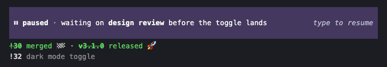
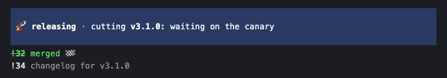
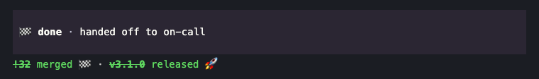
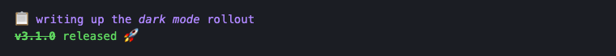

# What's new in 3.0

beacon 3.0 moves what it shows about a session out of iTerm2 and into Claude Code itself. Through 2.x, the session's lines lived in Claude Code's status line row and an iTerm2 status bar, and a declared mode repainted the whole pane. In 3.0 both live in one panel above the prompt, which Claude Code draws in any terminal. iTerm2 keeps the tab: its color, its two-line label, and the mode's glyph.

Coming from 2.x? [Migrating from 2.x](#migrating-from-2x) lists what to do, which for most installs is running `/beacon:install-beacon` once.

## The status panel

One panel sits above the prompt in every session, with nothing to turn on. Its top row names the session's project, its branch (colored by how it sits against its upstream, and linked to its page when it has one), and its task. Under that are the lines the status line used to carry: what the session shipped, and the change requests and issues it's working. Two buttons at the end of the top row open the project page and the session's directory in your editor; `w` and `c` press them once the panel has focus.

It replaces both the status line row and the iTerm2 status bar, and it works the same in Ghostty, WezTerm, VS Code's terminal, or anything else that runs Claude Code. See [the status panel](/statusline).

## Modes show in the panel

A mode you declare (`pause`, `release`, `done`) now opens the panel with a bar in the mode's own hue, carrying its glyph, its name, and your note. The mode's name also joins the labels at the right of Claude Code's footer, so it still shows with the panel collapsed. Your pane keeps its own background in every mode, and the bar's text meets WCAG AA contrast on every hue; the hues and their ratios are on [the palette](/palette).

**`pause`**: you've stepped away. The bar says *type to resume*, since your next prompt does exactly that.



**`release`**: a release is underway. It stays until you leave it.



**`done`**: the session is finished and ready to hand off. Its bar is the dimmest, so a finished session reads as lights out.



**`retro`**: writing up what happened. A retro runs long, so it has no bar: its note takes the panel's first line, led by its glyph, and the glyph also leads the top row, as it leads the tab.



## The pop-out is the dashboard, stacked

The dashboard's **pop out** button (Chrome and Edge) opens a small window that stays on top of everything else. It now holds every session the dashboard shows, in the same order, as one column of compact tiles, where it used to start with only the sessions waiting on you. Each tile is one line: the session's project, branch, and task, its activity dot and age, and buttons to raise its window (`go →`) and open its project page and directory. Click a tile to expand it to its mode's note, its latest turn, and the change requests and issues it's working. A mode marks a tile with its glyph and an edge in its color, and a paused or finished session's tile recedes behind the ones still working.


## Switch to the session that needs you

Command-Option-] raises the next beacon session and Command-Option-[ the previous one, the sessions waiting on you first. Command-Option-/ opens a list to choose from, and `/beacon switch` shows the same list in the panel. From a shell, [`beacon switch`](/cli?id=beacon-switch) does the same.

## Also in 3.0

- **Colors meet WCAG AA.** Every color beacon draws in the terminal reaches 4.5:1 contrast on Dracula's background.
- **Turn off what beacon does with a sibling's announcement.** `git config --global beacon.subscribe.anchor false`, or `beacon.subscribe.tack false`, or one event at a time. See [turning a reaction off](/?id=turning-a-reaction-off).
- **Every session shows, however beacon was loaded.** State now lives in one place, `~/.local/state/beacon`, so a session loading beacon from a local checkout and one using the installed plugin both appear in the dashboard and `beacon wip`. Through 2.x each kept its own directory and the sessions view showed only one set.
- **`beacon config` offers the iTerm2 restart itself** when a tab or pane setting needs one, instead of telling you to run another command.

## Migrating from 2.x

**Update Claude Code to 2.1.287 or later**, which the panel needs. Then, after [updating beacon](/?id=upgrade), run this once in a Claude Code session:

```
/beacon:install-beacon
```

Run it as the slash command rather than `beacon install` from a shell: the shell's `beacon` still points at the version you're leaving until this rewrites it. That covers most installs. The first run copies your 2.x session state into its new home, `~/.local/state/beacon`. It also removes the `statusLine` 2.x wrote into `~/.claude/settings.json`, writes the new `beacon` iTerm2 profile, and removes the old ones. Open panes move to the new profile on their next update, with nothing to restart.

Check the rest against your setup:

| If you… | Then |
|:---|:---|
| sync `~/.claude/settings.json` from somewhere else | remove the `statusLine` that runs `beacon statusline` there too, or the row comes back and repeats the panel's lines. `beacon doctor` flags one that's still set. |
| set `statusbar.buttons.<name>.cmd` in `~/.config/beacon/config.json` | move it to `buttons.<name>.cmd`. beacon no longer reads the old key. Button labels are no longer configurable: the panel labels each button by what it opens. |
| named the `beacon-dev` profile in a script, an AppleScript, or a key binding | use `beacon`. The profile keeps its GUID, so iTerm2's default-profile setting and existing windows follow it on their own. |
| used `beacon config status-panel` or `/beacon on` / `off` | drop them: the panel is always on, so there is nothing to switch. |
| run your own dashboard against `beacon serve` | `/mode-bg/<mode>` is gone, since mode cards take the bar's hue. The pop-out's new `/panel/<hash>` and `/open` routes fall under the same `focus_origins` allowlist as the others. |

The pause, release, and done pane backgrounds and their watermarks are gone with nothing to replace them: the panel's bar and the tab's glyph carry the mode.

The full list of changes is in the [changelog](https://github.com/chris-peterson/beacon/blob/main/CHANGELOG.md).
